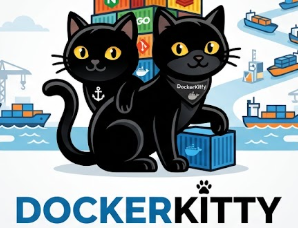

<p align="center">
  
</p>

<h1 align="center">🐱 DockerKitty</h1>

<p align="center">
  <b>Automated Dockerfile & Requirements Generation for Python Projects</b><br>
</p>

---

## 📌 About the Project

**DockerKitty** analyzes your Python script, automatically detects all third-party dependencies (via `ast`), generates a `requirements.txt`, and builds an optimized `Dockerfile` tailored to your app.

### Features
* 🔍 **Automatic Import Detection:** Scans your `.py` files and automatically filters out built-in standard libraries (`os`, `sys`, etc.).
* 📦 **Requirements Generator:** Creates a `requirements.txt` if one doesn't exist yet.
* ⚡ **Optimized Dockerfile:** Follows best practices (slim base image, `/app` working directory, efficient layer caching).

---

## 🛠️ Quickstart

### Prerequisites
* Python 3.10 or newer
* [Docker Desktop](https://www.docker.com/) installed and running

### 1. Clone the Repository
```bash
git clone [https://github.com/PatrickSantoZZ/dockerkitty.git](https://github.com/PatrickSantoZZ/dockerkitty.git)
cd docker-kitty